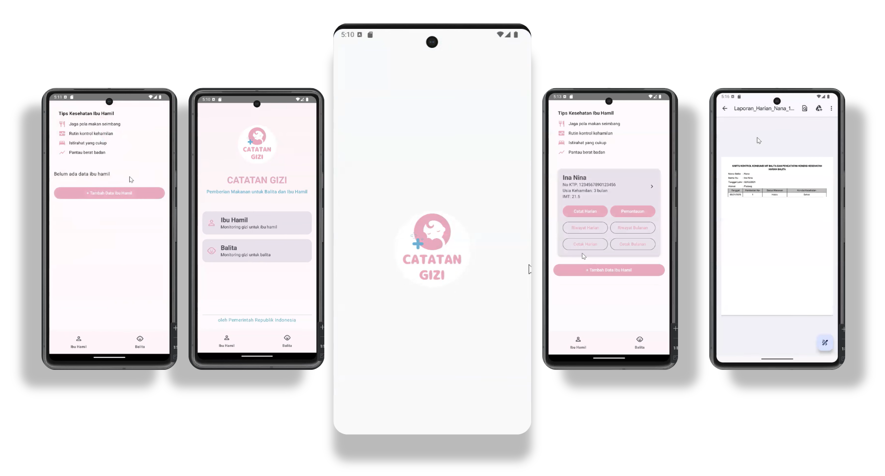

# 🤰 Catatan Gizi: Maternal & Child Nutrition Tracker

  

## 📌 Overview

**Catatan Gizi** is a native Android application developed entirely in **Kotlin**. It is designed with a strong social impact focus: to monitor, record, and improve the nutritional health of pregnant women (Ibu Hamil) and toddlers (Balita) in Indonesia. 

  

## 🚀 Key Features

*   **Targeted Health Profiling:** Separate, specialized dashboards and data entry flows for Pregnant Women and Toddlers.
*   **Nutrition & Growth Tracking:** Allows continuous monitoring of vital health metrics (e.g., weight, diet control).
*   **Automated Reporting:** Generates structured daily/monthly health reports based on the inputted health parameters.
*   **Native Performance:** Built specifically for the Android ecosystem ensuring smooth navigation, offline capabilities, and a highly responsive user interface.

## 💻 Tech Stack
*   **Language:** Kotlin (100%)
*   **Environment:** Android Studio, Android SDK
*   **UI/UX:** XML Layouts, Material Design
